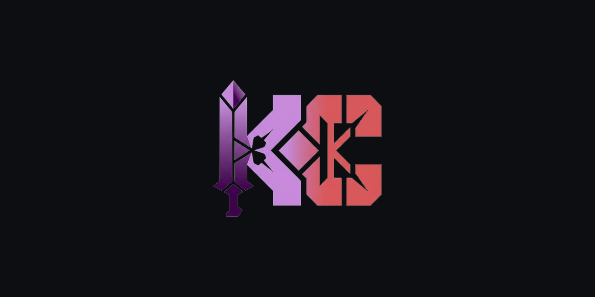
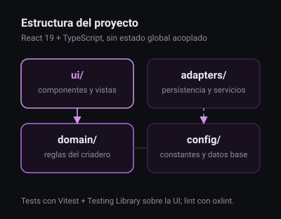

<a id="top"></a>

<div align="center">



<h1>Diosesmon Crianza</h1>

<p><strong>Cruces, IVs y roles en una sola vista: planificar la crianza sin planillas sueltas.</strong></p>

<p>
  
  
  
  <a href="https://github.com/KapsCa/Diosesmon-Crianza/releases"></a>
</p>

<p>
<a href="#que-hace"><strong>Qué hace</strong></a> &bull;
<a href="#estructura"><strong>Estructura</strong></a> &bull;
<a href="#stack"><strong>Stack</strong></a> &bull;
<a href="#desarrollo"><strong>Desarrollo</strong></a> &bull;
<a href="#estado"><strong>Estado</strong></a>
</p>

</div>

---

<p>
Una herramienta para quien cría en <strong>Diosesmon</strong>: ordena la información que normalmente vive
repartida entre notas, calculadoras y memoria, y la muestra donde importa. El objetivo no es automatizar
la decisión — es que puedas verla.
</p>

## Qué hace

- Arma y compara cruces con la información relevante a la vista.
- Gestiona el banco de progenitores y el inventario de capturas por bioma.
- Perfila IVs sobre el espécimen que estás por criar.
- Deja las reglas del servidor visibles, para no planificar sobre supuestos equivocados.

## Estructura



Separación por responsabilidad, con componentes de UI en diseño atómico:

```
src/
├── adapters/ui/components/   atoms · molecules · organisms
├── domain/                   data · services · types (reglas del criadero)
└── assets/                   sprites e imágenes
tests/                        UI, dominio y helpers (Vitest + Testing Library)
docs/                         documentación del proyecto
```

## Stack

| Pieza | Elección |
|---|---|
| UI | React `19` + TypeScript |
| Estilos | Tailwind CSS `4` |
| Build | Vite |
| Iconografía | `lucide-react` |
| Pruebas | Vitest + Testing Library (`happy-dom`) |
| Calidad | `oxlint` + `biome` |
| Releases | `release-please` |

## Desarrollo

```bash
npm install
npm run dev      # http://localhost:3000
```

```bash
npm test         # suite completa
npm run lint     # oxlint
npm run build    # build de producción
```

## Estado

En desarrollo activo: crece por incrementos, con pruebas que acompañan cada funcionalidad y releases
generadas desde los commits.

## Licencia

Uso personal del autor. El kit de marca vive en [`kapsca-brand`](https://github.com/KapsCa/kapsca-brand).
